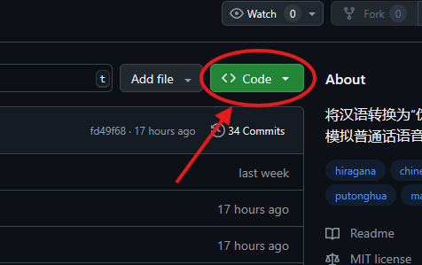

# 安装方式

> [!NOTE]
> 本文档适用于 **2.0** 版以上。旧版安装文档见 [archive/1.0/installation.md](archive/1.0/installation.md)。

## 0. 目录

- [从PyPI安装](#1-从pypi安装)
- [从wheel安装](#2-从本地wheel发行文件安装)
- [从sdist安装](#3-从本地源码发行文件安装)
- [从源代码构建](#4-从github源码编译发行文件)


## 1. 从PyPI安装

最经典的安装方法。首先确保您的设备上安装了 Python 解释器（版本至少为3.9）和 pip。

在终端输入如下命令将安装yukkuri-mandarin包以及两个可选依赖包，获得最完整的体验：

```bash
pip install yukkuri-mandarin[all]
```

如果因为某种原因不能安装可选依赖包，您可通过以下方式安装：

```bash
pip install yukkuri-mandarin
```

或者仅安装一个可选依赖包：

```bash
pip install yukkuri-mandarin[jieba]
```

```bash
pip install yukkuri-mandarin[openpyxl]
```

如果您是想升级，请运行以下命令：

```bash
pip install --upgrade yukkuri-mandarin
```


## 2. 从本地wheel发行文件安装

### 2.1 下载`.whl`文件

访问本项目的[PyPI页面](https://pypi.org/project/yukkuri-mandarin/)或者[GitHub Release页面](https://github.com/wubzbz/yukkuri-mandarin/releases)，下载最新版本的`.whl`文件（通常命名为`yukkuri-mandarin-x.x.x-py3-none-any.whl`）。

### 2.2 本地安装

下载完成后，在终端中执行以下命令进行安装：

```bash
pip install yukkuri-mandarin-<版本号，比如2.0.0>-py3-none-any.whl
```
> [!IMPORTANT]
> 请将`yukkuri-mandarin-x.x.x-py3-none-any.whl`替换为您实际下载的文件名。

> [!IMPORTANT]
> 如果wheel文件不在当前目录，请使用文件所在目录进行安装，比如`pip install path/to/yukkuri-mandarin-x.x.x-py3-none-any.whl`。


## 3. 从本地源码发行文件安装

### 3.1 下载`.tar.gz`文件

从项目的[PyPI页面](https://pypi.org/project/yukkuri-mandarin/)或[GitHub Release页面](https://github.com/wubzbz/yukkuri-mandarin/releases)下载源码压缩包（通常命名为`yukkuri-mandarin-x.x.x.tar.gz`）。

### 3.2 本地编译安装

使用pip进行安装即可，操作和安装wheel文件类似。

```bash
pip install yukkuri-mandarin-<版本号>.tar.gz
```


## 4. 从GitHub源码编译发行文件

### 4.1 克隆仓库到本地

点击GitHub仓库右上角绿色的code按钮，选择克隆仓库到本地。



### 4.2 同步开发环境

> [!NOTE]
> 在执行以下步骤之前，请先安装 [uv](https://docs.astral.sh/uv/)。

本项目使用 uv 管理开发环境与依赖锁定（`uv.lock`），在仓库根目录执行：

```bash
uv sync --all-extras
```

该命令会自动创建 `.venv` 并安装包本身、全部可选依赖和开发依赖。

### 4.3 构建发行文件

```bash
uv build
```

此命令会在`dist/`目录下生成`.whl`和`.tar.gz`发行文件。

构建完成后，您可以使用前述方法安装生成的发行文件。

---

**注意** :warning: ：如果您不确定安装是否会带来依赖项冲突，建议在虚拟环境中进行安装，以避免与系统Python环境冲突。可以使用`venv`或`virtualenv`创建虚拟环境：

```bash
# 创建虚拟环境
python -m venv myenv

# 激活虚拟环境（Linux/macOS）
source myenv/bin/activate

# 激活虚拟环境（Windows）
myenv\Scripts\activate
```


