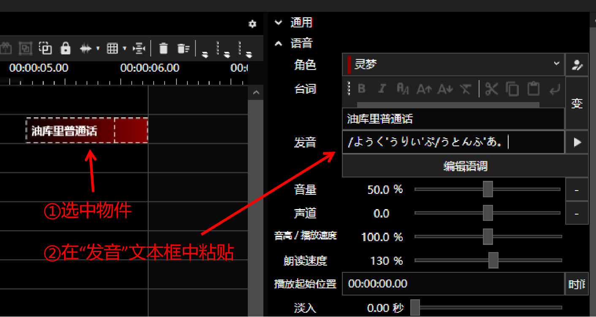
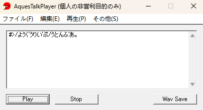
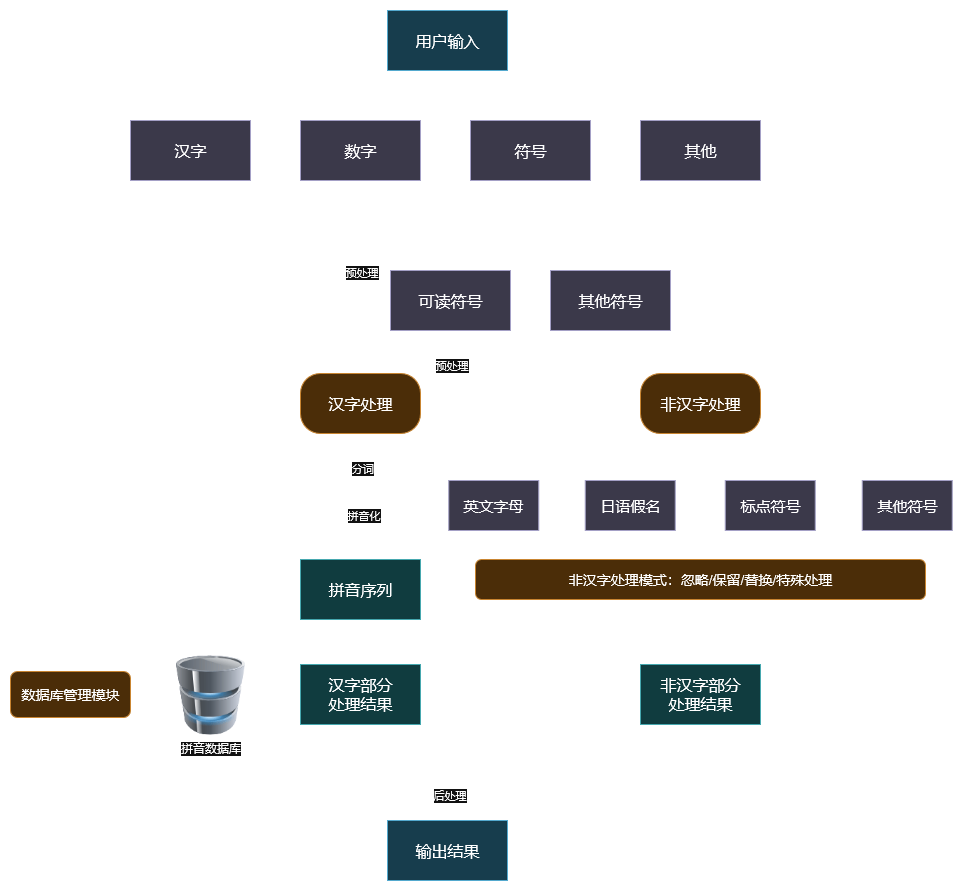
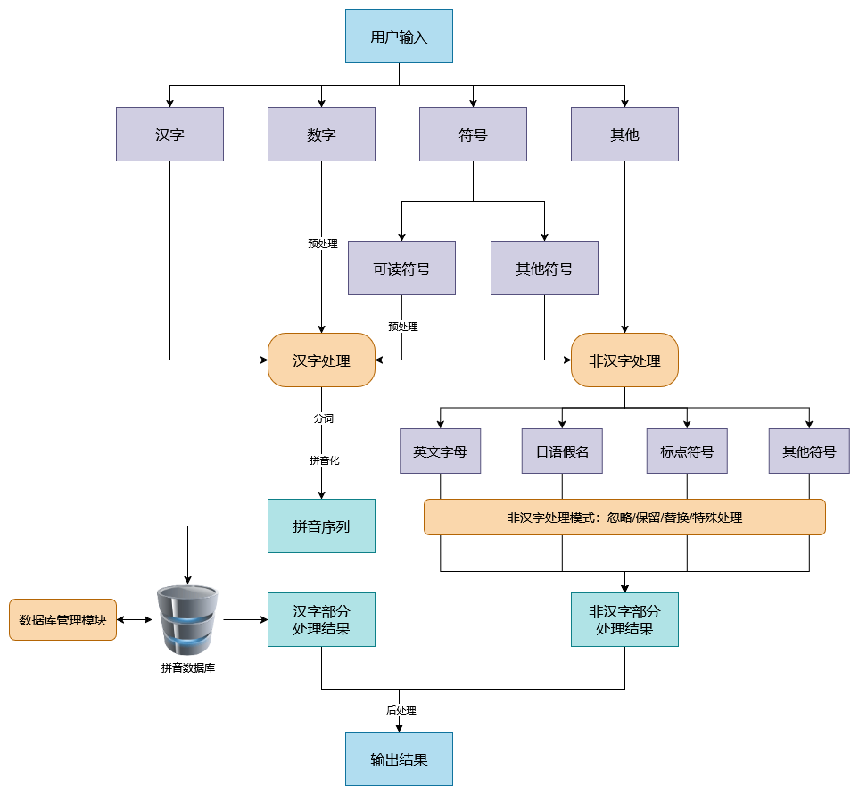

# 油库里普通话功能详解

> [!NOTE]
> 本文档适用于 **2.0** 版以上。旧版文档见 [archive/1.0/usage.md](archive/1.0/usage.md)。

## 0. 目录

- [文字转换](#1-文字转换)
- [拼音转换](#2-拼音转换)
- [批量转换与性能](#3-批量转换与性能)
- [从 1.0 迁移](#4-从-10-迁移)

> [!IMPORTANT]
> 油库里普通话的 PyPI 项目名是 `yukkuri-mandarin`，在 `pip install` 时请使用这个名称；
> 而 Python 包名是 `yukkurimandarin`（中间没有连字符），在 `import` 的时候请使用这个名称。

## 1. 文字转换

### 1.1 基础用法

文字转换功能将中文句子转换为“伪日本语”：

```python
import yukkurimandarin as ym

result = ym.text_convert("油库里普通话。")
print(result)
```

输出类似于：

```text
/ようく'う/りい'ぷ/うとんふ'あ。
```

复制输出的内容，将其粘贴到支持[音声记号](https://github.com/wubzbz/Yukkuri-Mandarin/blob/main/docs/phonology.md#3-什么是音声记号)的油库里语音生成器中，即可生成中文油库里语音。

#### 一、（推荐）在[油库里MovieMaker](https://manjubox.net/ymm4/)中使用



首先在时间轴选中语音物件，将生成的“伪日本语”粘贴到右侧物件编辑面板—“语音”—“发音”文本框中。**请注意是“发音”文本框**而不是“台词”文本框。然后点击右侧的播放按钮，确认生成的语音是否符合要求。

> [!TIP]
> 推荐使用[Re-Hatsuon Tool](https://github.com/wubzbz/ReHatsuonTool)软件向YukkuriMovieMaker4项目添加普通话语音物件。它具有直观的图形界面，简便的操作方法和完善的台词编辑能力。


#### 二、在[AquesTalkPlayer](https://www.a-quest.com/products/aquestalkplayer.html)中使用

在AquesTalkPlayer中使用音声记号标记的文本时，需要在其开头加上`#>`。要实现这一点非常简单，只需要稍微修改一下你的代码：

```python
import yukkurimandarin as ym

result = ym.text_convert("油库里普通话。")
print(f"#>{result}") # 使用f-字符串为伪日本语的开头添加#>
```

接着，将生成的“伪日本语”粘贴到文本框中，点击Play即可播放。如下图所示：



#### 三、在[ゆっくも！](https://www.yukumo.net/)中使用

首先点击网页顶部的"Pro"，切换到Pro模式。此时会出现一左一右两个文本框，如下图所示：


将转换后的发音粘贴到**右侧**的“発音記号”文本框中，即可播放和下载音频。

> [!NOTE]
> Yukumo支持的AquesTalk音声记号版本是1.7，而本项目是基于2.0版开发的。如果您在使用过程中发现问题，请向本项目提交[Issue](https://github.com/wubzbz/Yukkuri-Mandarin/issues)。

#### 四、在[VoiceVox](https://voicevox.hiroshiba.jp/)中使用

> [!NOTE]
> 此特性我也不知道啥时候实装。

基本思路：根据分词确定断/合，五度标记法构造声调。

TODO:

- [ ] 移除音声记号、片假名注音（最易）
- [ ] 声调-音高映射
- [ ] 无声化、重音核
- [ ] 声韵长度、抑扬、其他参数

#### 五、注意事项

- 如果您使用上述语音生成软件以外的生成工具，请确认其是否支持[音声记号](https://github.com/wubzbz/Yukkuri-Mandarin/blob/main/docs/phonology.md#3-什么是音声记号)。如果不支持，可以设置`text_convert()`的参数`without_accent`为`True`，以获得不含音声记号的结果。
- 如果您使用的语音生成工具对音声记号的定义与本项目采用的不一致，您可以选择[自建拼音数据库](https://github.com/wubzbz/Yukkuri-Mandarin/blob/main/docs/database-mngr.md)。
- 有时候会出现无法生成语音的情况。请首先检查生成的“伪日本语”中是否包含语音转换工具不支持的字符。例如，一些终端在输出结果时，会自动为行末的半角字符位补一个**空格**以满足行宽。如果您采用复制终端输出的方法，请检查是否包含这种多余的空格。考虑到这种情况，更建议您采用将结果输出到文件中再复制的方式。

### 1.2 高级用法





```python
def text_convert(
    sentence: str,
    *,
    without_accent: bool = False,
    config: Config = DEFAULT_CONFIG,
    tokenizer: Optional["Tokenizer"] = None,
) -> str
```

#### `sentence`：待转换的句子（字符串）

中文句子，可以包含阿拉伯数字。不超过 13 位的整数会按中文习惯读出，例如 `666` 读作“六百六十六”。如果想让数字像电话号码一样逐位读出，在数字末尾加一个空格，例如 `666 ` 读作“六六六”；以 0 开头或整数位超过 13 位的数字也会逐位读出。

#### `without_accent`：是否去除音声记号（布尔）

设置为 `True` 时，生成的汉字段会去掉音声记号；`keep` 模式保留下来的原文（例如 `a_b`、片假名）不会被改动。

```python
import yukkurimandarin as ym

result1 = ym.text_convert("你干~嘛？哎哟！", without_accent=False)
result2 = ym.text_convert("你干~嘛？哎哟！", without_accent=True)

print("含音声记号：", result1)
print("不含音声记号：", result2)
```

您可以通过上面这个示例进行试验，结果应该类似于：

```text
含音声记号： 'に/いが'ん、/っまあ?/っあいよお。
不含音声记号： にいがん、っまあ?っあいよお。
```

#### `config`：转换配置（`Config`）

`Config` 是不可变 dataclass，包含两个字段：

| 字段 | 类型 | 说明 |
|---|---|---|
| `database` | `str \| Path \| None` | 拼音数据库路径；`None` 表示内置只读库 |
| `non_hanzi` | `NonHanziModes \| None` | 非汉字处理方式；`None` 表示库的默认处理 |

```python
from yukkurimandarin import Config, text_convert

config = Config(database="my_database.db")
print(text_convert("两块钱一斤。", config=config))
```

自定义库在转换路径中默认**只读**打开；如果它还是旧版 schema，会先自动迁移一次（需要写权限），然后继续只读。内置库始终只读，不能覆盖。

需要派生配置时用 `dataclasses.replace`：

```python
import dataclasses
from yukkurimandarin import DEFAULT_CONFIG

config = dataclasses.replace(DEFAULT_CONFIG, database="my_database.db")
```

#### `non_hanzi`：非汉字字符处理模式

非汉字字符分为英文字母（en）、日语假名（ja）、标点符号（pc）和其他字符（other）四类。每类支持 4 种模式：

- `"ignore"`：忽略该片段
- `"keep"`：保留原样
- `"replace"`：替换为对应的 `*_replace` 字符串
- 可调用对象：接收片段字符串，返回替换文本

```python
from yukkurimandarin import Config, NonHanziModes, text_convert

my_config = Config(
    non_hanzi=NonHanziModes(en_mode="ignore", ja_mode="keep")
)
print(text_convert("He said: こんにちは！", config=my_config))
```

替换模式：

```python
my_config = Config(
    non_hanzi=NonHanziModes(en_mode="replace", en_replace="@")
)
```

自定义函数：

```python
def to_upper(fragment: str) -> str:
    return fragment.upper()

my_config = Config(non_hanzi=NonHanziModes(en_mode=to_upper))
```

`global_mode` / `global_replace` 为所有类别提供默认值；未单独指定的类别会回落到全局值：

```python
my_config = Config(
    non_hanzi=NonHanziModes(
        en_mode=to_upper,
        global_mode="replace",
        global_replace="@",
    )
)
```

> [!TIP]
> 如果 `config.non_hanzi` 保持默认的 `None`，标点会被清洗成适合语音合成的形式，日语假名会统一转成平假名，英文和其他字符会被忽略。实现见 [`pipeline/non_hanzi.py`](https://github.com/wubzbz/Yukkuri-Mandarin/blob/main/yukkurimandarin/pipeline/non_hanzi.py)。

#### `tokenizer`：jieba 分词器

> [!NOTE]
> 使用此参数前请确保已安装 `jieba`（`pip install yukkuri-mandarin[jieba]`）。

可以传入自定义的 `jieba.Tokenizer`，通过用户词典等方式优化分词和多音字读音：

```python
from jieba import Tokenizer
import yukkurimandarin as ym

my_tokenizer = Tokenizer()
my_tokenizer.add_word("参差不齐")
my_tokenizer.load_userdict("user_dict.txt")

result = ym.text_convert("普通人参差不齐的水平", tokenizer=my_tokenizer)
print(result)
```

> [!TIP]
> 未传入 `tokenizer` 时，库会使用进程内共享的默认分词器：第一次调用需要加载词典（约 0.3–0.4 秒），之后复用。即使如此，批量转换仍建议复用 `Converter`，避免每次调用重新打开数据库。

#### `Converter`：复用连接与分词器

```python
from yukkurimandarin import Converter

with Converter() as conv:
    for sentence in ["你好。", "今天天气不错。"]:
        print(conv.text_convert(sentence))
```

`Converter` 懒加载数据库连接与分词器，退出 `with` 时关闭连接；也可以手动调用 `conv.close()`。需要自定义配置时：

```python
from yukkurimandarin import Config, Converter

with Converter(Config(database="my_database.db")) as conv:
    print(conv.text_convert("你好。"))
```

## 2. 拼音转换

### 2.1 基础用法

拼音转换允许将以空格分开的拼音序列转换为“伪日本语”，适合需要精确控制音节和声调的场景。

使用拼音转换函数可以让您更自由地掌握音节和音调，这在某些需要特殊发音的场景特别有效。您甚至可以通过[数据库管理模块](https://github.com/wubzbz/Yukkuri-Mandarin/blob/main/docs/database-mngr.md)添加特殊发音，实现无对应汉字的音节转换（例如`giao`）。

但另一方面，您的输入需要严格遵守拼音序列的格式：
- 以空格分割各个拼音与标点。
- 音节 + 声调数字：`1` 阴平、`2` 阳平、`3` 上声、`4` 去声、`5` 轻声；`0` 也视作轻声。
- 标点只有四种：英文逗号 `,`、英文句号 `.`、英文问号 `?`、英文分号 `;`，会映射为对应的输出标点。

例如，“油库里（慢速）普通话是什么？嗯，好问题。”可以写作：

```text
you2 ku4 li3 ; man4 su4 ; pu3 tong1 hua4 shi4 shen3 me5 ? en4 , hao3 wen4 ti2 .
```

鉴于拼音序列的语法要求比较严格，建议您指定参数`error`，以便检查哪些部分未能成功转换。如下例：

```python
import yukkurimandarin as ym

result = ym.pinyin_convert(
    "ya1 ha1 ha1 ha ha1 ,ji1 tang1 lai2 lo5 .",
    error="@",
)
print(result)
```

在这个例子中，输入的拼音序列存在两个问题：第四个拼音“ha”未标注声调，且逗号和拼音“ji1”之间没有用空格分开。输出的结果应类似：

```text
/っやあはあはあ@/っはあ@たあん/らいろお。
```

可见，出错的部分出现了我们指定的符号`@`。通过这种方式，您可以快速排除潜在的问题。

> [!TIP]
> `error="keep"` 会保留无法查询到的原音节，而不是替换成固定字符串。例如 `pinyin_convert("giao1", error="keep")` 会原样输出 `giao`。

### 2.2 高级用法

```python
def pinyin_convert(
    sentence: str,
    *,
    error: str = "",
    without_accent: bool = False,
    config: Config = DEFAULT_CONFIG,
) -> str
```

#### `sentence`：拼音序列（字符串）

格式见[基础用法](#21-基础用法)。`0` 与 `5` 都表示轻声。

#### `error`：查询失败时的占位符（字符串）

默认空字符串；传 `"keep"` 时保留原音节。其余值会原样插入输出。

#### `without_accent`：是否去除音声记号（布尔）

效果与 `text_convert` 的同名参数一致。

#### `config`：转换配置（`Config`）

与 `text_convert` 相同，可用 `Config(database=...)` 指定自定义数据库。示例：

```python
from yukkurimandarin import Config, pinyin_convert

config = Config(database="my_database.db")
print(pinyin_convert("ni3 hao3", config=config))
```

## 3. 批量转换与性能

jieba 分词器首次加载词典会消耗 0.3 ~ 0.5 秒左右。默认的 jieba 分词器是进程内单例，不会重复加载词典。如果您使用自定义分词器，尽量保持进程内复用即可。

顶层 `text_convert()` / `pinyin_convert()` 每次调用都会新建一个 `Converter`，数据库连接会重新打开，在处理数量大的时候可能造成一定的性能损耗。
因此，批量处理时建议复用 `Converter`：

  ```python
  from yukkurimandarin import Converter

  with Converter() as conv:
      results = [conv.text_convert(line) for line in lines]
  ```

## 4. 从 1.0 迁移

API 变化速查表：

| 1.0 | 2.0 |
|---|---|
| `text_convert(..., pinyin_database=dm)` | `text_convert(..., config=Config(database=path))` |
| `text_convert(..., non_hanzi_config=modes)` | `text_convert(..., config=Config(non_hanzi=modes))` |
| `DatabaseManager` | `PinyinRepository`（见[数据库管理](https://github.com/wubzbz/Yukkuri-Mandarin/blob/main/docs/database-mngr.md)） |

完整的旧版文档保存在 [archive/1.0/](archive/1.0/)。
